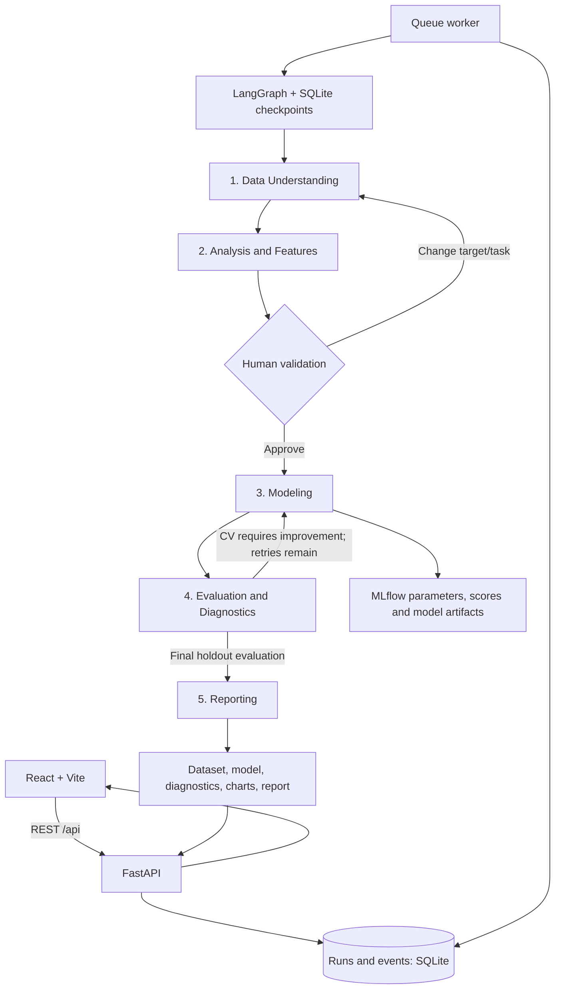

# Architecture and data flow

CloudFlow is a local, single-user application for bounded tabular classification and regression. The React application talks only to FastAPI REST endpoints. SQLite persists runs, events and atomic queue claims. A separate Python worker executes each segment in a child process; Docker Compose puts that worker in a non-root, resource-limited container.

## State and execution

- `shared/contracts.py` defines Pydantic request, plan, progress and pipeline schemas. Only JSON-compatible values cross agent boundaries; models and datasets live in the run directory.
- `orchestrator/graph.py` is the executable LangGraph. It uses a durable `interrupt()` before modeling and `Command(resume=...)` after a REST review submission.
- `shared/repository.py` uses `BEGIN IMMEDIATE` for queue claims, review submission and record mutations. Worker ownership is checked on stage writes. Approvals cannot be submitted twice.
- `orchestrator/worker.py` sends lease heartbeats, enforces a 30-minute execution-segment limit, and terminates a cancelled child. Runs interrupted by a worker failure are marked failed once their lease expires. A paused human checkpoint remains resumable across API/worker restarts.
- Cancellation is terminal. Failed runs retain their artifacts; starting a new analysis is the retry mechanism for infrastructure failures. Model-improvement retries are a separate bounded graph loop.
- The API never executes LLM-produced code. Optional Gemini/Groq reasoning produces validated JSON for problem interpretation and a clearly labeled report narrative. Invalid or unavailable reasoning falls back to local planning and records a warning.

## ML correctness

1. Validate the entire CSV, including headers, row widths, encoding and dimensions. Normalize blanks/infinities, remove exact duplicates and rows missing the selected target.
2. Reserve a reproducible random holdout (stratified for classification). EDA and feature proposals use training rows only.
3. Ask the user to review target, task, raw feature columns, models, imputation, scaling, date features, feature selection and class weighting. Changing the target or task rebuilds the split and EDA, then pauses again.
4. Fit raw type inference, date derivation, numeric imputation/scaling, category encoding and optional feature selection within each cross-validation fold using a scikit-learn Pipeline.
5. Compare a dummy baseline and approved candidate families on exactly the same folds. Tuning uses a small bounded grid. SVM, linear models, Random Forest, Gradient Boosting and XGBoost have classification/regression implementations. XGBoost classification preserves original string labels using a fitted encoder wrapper.
6. Base feedback only on CV baseline improvement, training-to-validation gap and classification quality. At most two additional parameter-search rounds run. The best score across all rounds is retained.
7. Evaluate the winner and a fitted dummy baseline on the same untouched holdout once. Report classification metrics, ROC-AUC when available, per-class diagnostics and confusion matrix, or MAE/RMSE/R² and residuals. Display negative CV loss values as positive MAE/RMSE in the UI.
8. Compute bounded SHAP explanations. For unsupported cases, record the reason and label the permutation-importance fallback explicitly. Export the training-fitted model, predictions, raw cleaned data, transformed training/test features, package versions, split indices and hashes.

Tuning CV scores are optimistic estimates; holdout metrics are the final assessment. Random splitting assumes independent observations. Time-series forecasting, group-aware validation, causal inference, unstructured modalities and multi-tenant hosting are outside this implementation's scope.

## Files and tools retained from the archives

The existing EDA schema, statistics, relationship analysis, chart planning and Matplotlib rendering modules are reused by the Analysis & Features agent. The original operation dispatcher remains useful for conservative standalone preparation. Its LLM-generated-code path has been replaced by trusted operations and a reproducibility notebook export.

The original classification helper API in `agents/modeling/{trainer,registry,evaluator}.py` and `shared/{modeling,modeling_plan,evaluation,artifacts}.py` remains available for its existing verification scripts. The full application uses `agents/feature_ml_agent/main.py`, `agents/modeling/models.py` and `shared/contracts.py`, which handle both tasks. The original regression split indentation bug is corrected. These compatibility helpers do not coordinate production runs.

## Deployment boundaries

Compose runs frontend, API and worker services. API and worker share one named volume; the API does not mount the Docker socket. The worker has no extra Linux capabilities, cannot gain privileges, uses a read-only image, and has CPU/memory/PID limits. API/worker image execution is non-root. Local Python execution is a development mode, not a security sandbox. The application binds to localhost by default and provides no authentication.

SQLite is appropriate for this single-host demo. A multi-user deployment needs authentication, authorization, dataset retention rules, a shared database/job broker, and storage scoped to each user.

## Implementation references

- [LangGraph interrupts and durable resume](https://docs.langchain.com/oss/python/langgraph/interrupts)
- [Scikit-learn preprocessing and leakage guidance](https://scikit-learn.org/stable/common_pitfalls.html)
- [MLflow experiment tracking](https://mlflow.org/docs/latest/ml/tracking/)
- [Gemini structured JSON output](https://ai.google.dev/gemini-api/docs/structured-output)
- [Groq chat API compatibility](https://console.groq.com/docs/openai)
